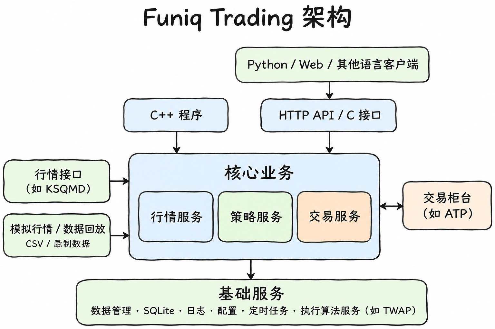

# Funiq Trading

Funiq Trading 是一个专业的量化交易系统，为您提供完整的行情接入、策略执行和交易管理解决方案。系统采用模块化设计，支持多种行情数据源和交易接口。

📖 **在线文档：[funiq-trading.funiqlab.com](https://funiq-trading.funiqlab.com)**

## 特性与功能

- **行情接入与回放**：支持扩展不同的行情接口，已接入 KSQMD；支持实时行情、模拟数据、CSV 文件和录制数据回放。
- **交易与账户管理**：支持扩展不同的交易柜台，已接入 ATP；支持多账户、下单、撤单，以及订单、成交、持仓和资金查询。
- **策略管理**：支持同时运行多个策略，分别设置参数、启动和停止。
- **执行算法服务**：提供 TWAP 拆单，将一笔交易分成多次执行，支持创建、查询和取消任务。
- **多种语言调用**：提供 HTTP API 和 C 接口，可使用 Python 等语言开发客户端。
- **配套功能**：提供数据保存、数据库升级、日志记录和定时启停。

## 设计优势

- **方便扩展**：行情、交易和策略分别管理，可以按需要增加或更换。
- **减少额外开销**：策略直接在 C++ 程序中处理数据，内部调用不需要经过网络。
- **方便开发和测试**：提供 Docker 开发环境、模拟行情和数据回放功能。

## 快速开始

推荐使用 Docker，避免手动配置编译环境。开始前请安装并启动 Docker，准备好 Git；使用 Python 客户端时还需要 Python 3。

```bash
# 1. 下载代码
git clone https://github.com/funiq-lab/funiq-trading.git
cd funiq-trading

# 2. 准备开发环境（首次使用时执行）
(cd docker && bash build.sh)

# 3. 编译项目
bash docker/run.sh build
```

按[开发指南](docs/DEVELOPMENT.md#准备配置)准备好配置文件后，进入容器：

```bash
bash docker/run.sh
```

在容器中启动程序：

```bash
cd /app
LD_LIBRARY_PATH=/app/build/build_x64/Release/lib ./build/build_x64/Release/bin/ft_trading_client
```

调试、清理和手动编译等用法见[开发指南](docs/DEVELOPMENT.md)。

## 系统架构



C++ 程序可以直接调用核心服务，策略也可以直接调用交易接口，不必经过网络。其他语言的客户端可通过 HTTP API 或 C 接口调用。

行情接口和交易柜台可以按需要扩展或更换，KSQMD、ATP 是目前已接入的例子。各模块共用数据缓存、SQLite、日志、配置、定时任务和执行算法服务（如 TWAP）等功能。详细设计见[架构文档](https://funiq-trading.funiqlab.com/getting-started/architecture)。

## 示例说明

仓库中的策略示例**仅用于展示策略的调用方式，不具备业务含义**，不发送真实订单。

## 更多信息

安装配置、接口说明和使用方式请查看[在线文档](https://funiq-trading.funiqlab.com)。

## 许可

项目自有代码使用 [MIT License](LICENSE)，第三方库与 SDK 保留其原始版权及许可条件。
