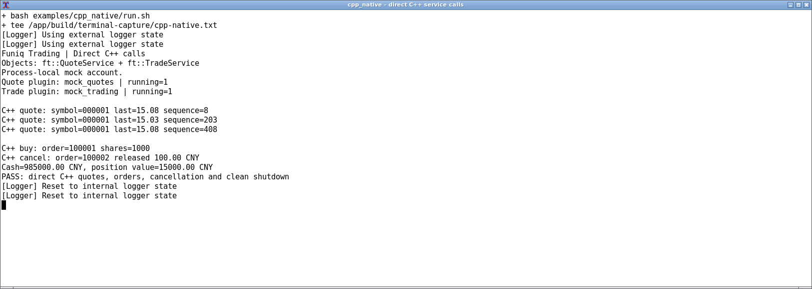

# Direct C++ calls

[简体中文](README.md) · English

This example creates quote and trade services inside a C++ program. It reads quotes, places a simulated buy, cancels a resting order and queries cash. Account state belongs to this process.

## Run

With Docker and Git installed, build from the repository root:

```bash
docker build -t funiq-trading-mock-dev -f examples/mock_core/Dockerfile .
docker run --rm -v "$PWD:/app" funiq-trading-mock-dev \
  bash examples/mock_core/build.sh
```

Run the example:

```bash
docker run --rm --network none -v "$PWD:/app" funiq-trading-mock-dev \
  bash examples/cpp_native/run.sh
```

## Result

The terminal shows three quote samples, a buy, a cancellation and cash balances. Starting cash is 1,000,000 CNY. After buying 1,000 shares, cash is 985,000 CNY and the position value is 15,000 CNY. Services stop when the program finishes.



[Original output](../../docs/assets/mock-demo/cpp-native.txt)

## Code

`main.cpp` creates `ft::QuoteService` and `ft::TradeService` and calls their C++ objects. `run.sh` sets the library path and launches the program.

Mock plugins generate quotes locally and fill `000001` at a fixed reference price of 15 CNY. Each run creates a fresh simulated account.
