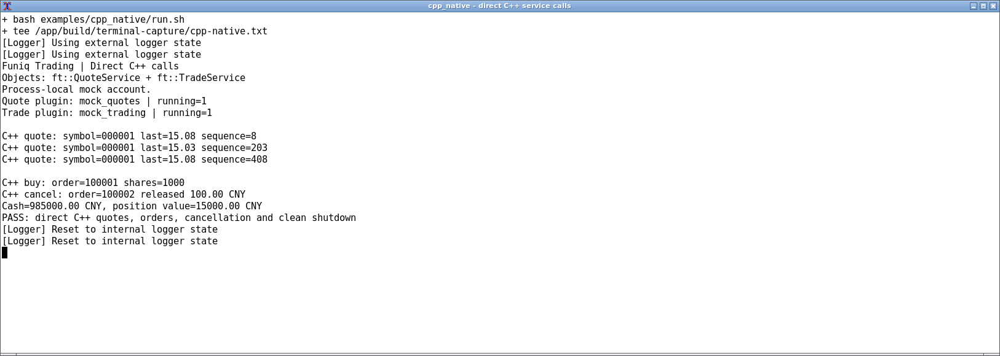

# C++ 直接调用核心

简体中文 · [English](README.en.md)

本例在 C++ 程序中创建行情和交易服务。程序读取行情、模拟买入、撤销挂单，再查询资金。账户和订单保存在这个程序的内存中。

## 运行

准备 Docker 和 Git，在仓库根目录编译：

```bash
docker build -t funiq-trading-mock-dev -f examples/mock_core/Dockerfile .
docker run --rm -v "$PWD:/app" funiq-trading-mock-dev \
  bash examples/mock_core/build.sh
```

运行示例：

```bash
docker run --rm --network none -v "$PWD:/app" funiq-trading-mock-dev \
  bash examples/cpp_native/run.sh
```

## 运行结果

终端显示三次行情、买入订单、撤单结果和资金余额。示例初始现金为 100 万元；买入 1,000 股后，现金为 985,000 元、持仓价值为 15,000 元。程序结束时停止服务。



[原始输出](../../docs/assets/mock-demo/cpp-native.txt)

## 代码说明

`main.cpp` 创建 `ft::QuoteService` 和 `ft::TradeService`，通过服务对象读取行情和操作订单。`run.sh` 设置库路径并运行程序。

示例使用 mock 行情和交易插件。行情在本地生成，`000001` 按固定参考价 15 元模拟成交。每次运行都会创建新的模拟账户。
