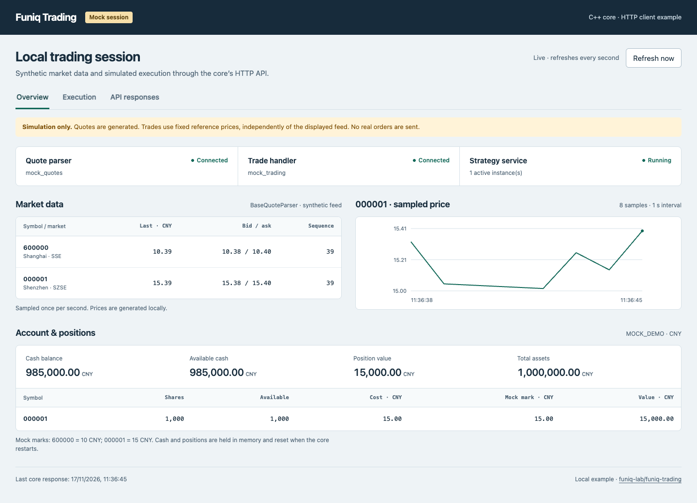
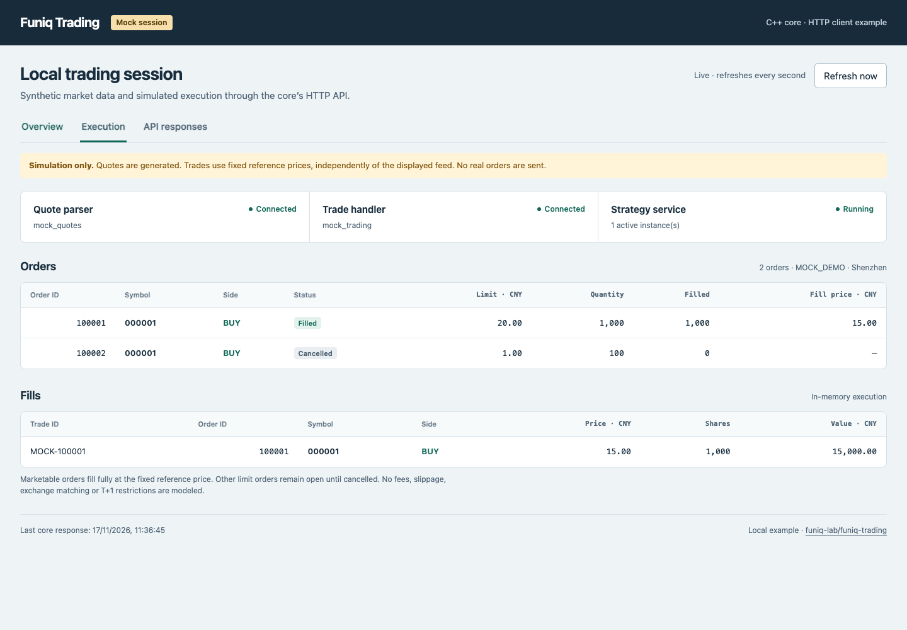

# Web access through HTTP

[简体中文](README.md) · English

This example displays service status, quotes, account state, orders and fills in a browser. A local Python server serves the page and calls the core's HTTP endpoints.

## Run

With Docker, Git and Python 3 installed, build and start the core from the repository root:

```bash
docker build -t funiq-trading-mock-dev -f examples/mock_core/Dockerfile .
docker run --rm --name funiq-trading-mock \
  -p 127.0.0.1:18080:8080 -v "$PWD:/app" \
  funiq-trading-mock-dev bash examples/mock_core/start.sh
```

In another terminal:

```bash
python3 examples/http_web/exercise.py
python3 examples/http_web/viewer.py
```

Open **http://127.0.0.1:18081**.

## Result

The page refreshes every second. Overview shows services, quotes and accounts; Execution shows simulated fills and cancellations; API responses shows the received data.





## Code

`viewer.html` displays the data. `viewer.py` serves the page and gathers read requests through `/snapshot`. `exercise.py` creates simulated buys and cancellations for the page to show.

The core uses mock plugins with 1,000,000 CNY starting cash. `000001` fills at a fixed reference price of 15 CNY. Restarting the core resets its account.

## Stop

Press Ctrl-C in the Web server terminal, then run:

```bash
docker stop funiq-trading-mock
```
