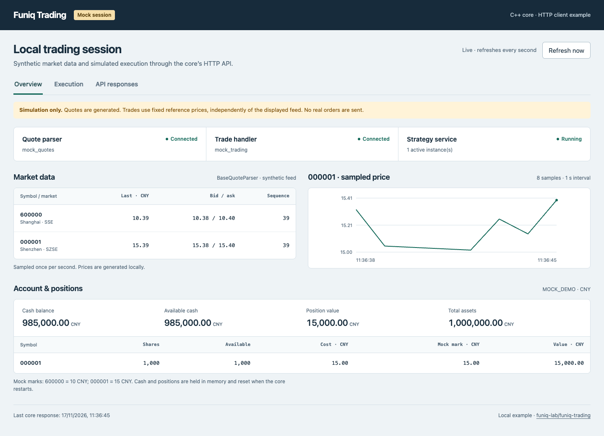
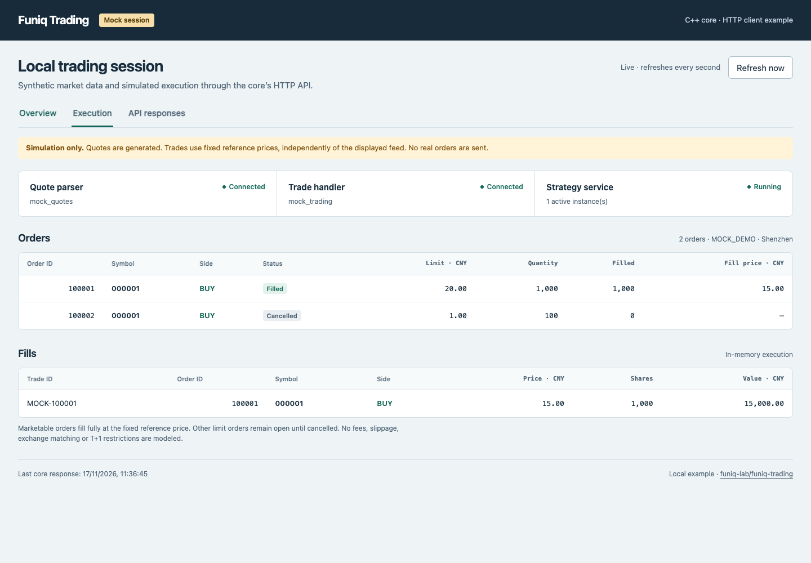

# Web 通过 HTTP 接入核心

简体中文 · [English](README.en.md)

本例用网页查看核心的服务状态、行情、账户、订单和成交。浏览器读取本地 Python 服务，Python 服务再调用核心的 HTTP 接口。

## 运行

准备 Docker、Git 和 Python 3，在仓库根目录构建并启动核心：

```bash
docker build -t funiq-trading-mock-dev -f examples/mock_core/Dockerfile .
docker run --rm --name funiq-trading-mock \
  -p 127.0.0.1:18080:8080 -v "$PWD:/app" \
  funiq-trading-mock-dev bash examples/mock_core/start.sh
```

在另一个终端执行：

```bash
python3 examples/http_web/exercise.py
python3 examples/http_web/viewer.py
```

打开 **http://127.0.0.1:18081**。

## 运行结果

网页每秒刷新。概览页显示服务、行情和账户，订单页显示模拟成交与撤单，API 响应页显示收到的数据。





## 代码说明

`viewer.html` 负责显示数据。`viewer.py` 提供页面，并通过 `/snapshot` 汇总核心的查询结果。`exercise.py` 用于产生模拟买入和撤单，供页面展示。

核心使用 mock 插件，账户初始现金 100 万元，`000001` 按固定参考价 15 元模拟成交。重启核心后账户重置。

## 停止

在网页服务终端按 Ctrl-C，再执行：

```bash
docker stop funiq-trading-mock
```
