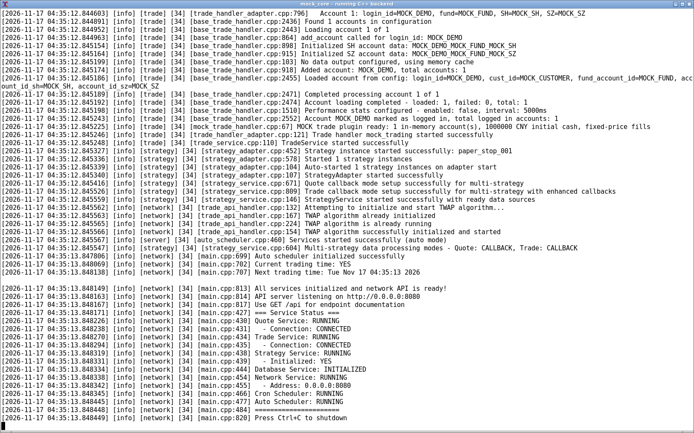
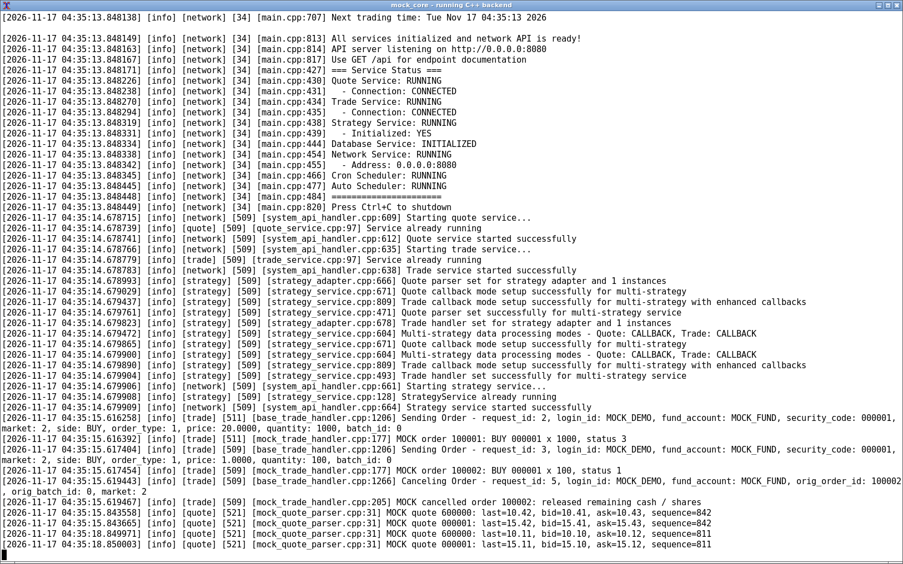

# Core backend and logs

[简体中文](README.md) · English

This example starts the standalone C++ core. It loads mock quote/trade plugins and continuously writes service status, quotes and execution events to the terminal.

## Start the backend

With Docker and Git installed, run from the repository root:

```bash
docker build -t funiq-trading-mock-dev -f examples/mock_core/Dockerfile .
docker run --rm --name funiq-trading-mock \
  -p 127.0.0.1:18080:8080 -v "$PWD:/app" \
  funiq-trading-mock-dev bash examples/mock_core/start.sh
```

The terminal first shows the build and checks, then launches `ft_trading_client`. `Quote Service: RUNNING`, `Trade Service: RUNNING`, `Strategy Service: RUNNING` and `API server listening` confirm that the backend is running. This terminal stays open.



## View runtime logs

The quote plugin logs a cached quote every three seconds. Follow the same backend from another terminal:

```bash
docker logs -f funiq-trading-mock
```

Run a simulated buy and cancellation:

```bash
python3 examples/http_web/exercise.py
```

Order submission, mock fills and cancellation appear in the backend terminal.



[Complete captured log](../../docs/assets/mock-demo/core-full.txt)

## Files

`start.sh` starts the core with console/file logging enabled. `quote_parser/` generates quotes; `trade_handler/` holds mock accounts and orders; `*_config.json` selects the plugins and accounts. Runtime files stay under `build/mock-run/`.

Accounts start with 1,000,000 CNY. Fixed execution reference prices are 10 CNY for `600000` and 15 CNY for `000001`; other limit orders remain open until cancelled. Restarting the backend resets its account.

## Stop

Press Ctrl-C in the backend terminal or run:

```bash
docker stop funiq-trading-mock
```
