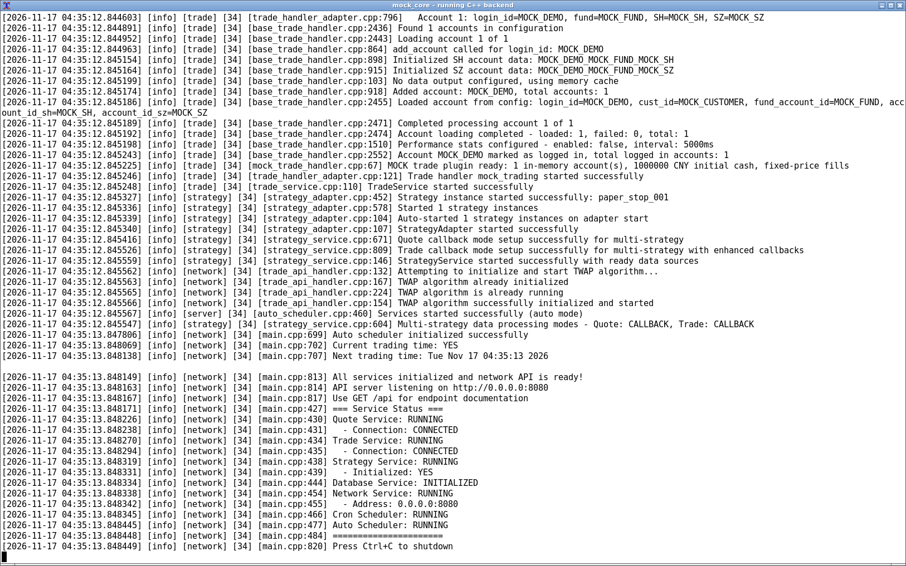
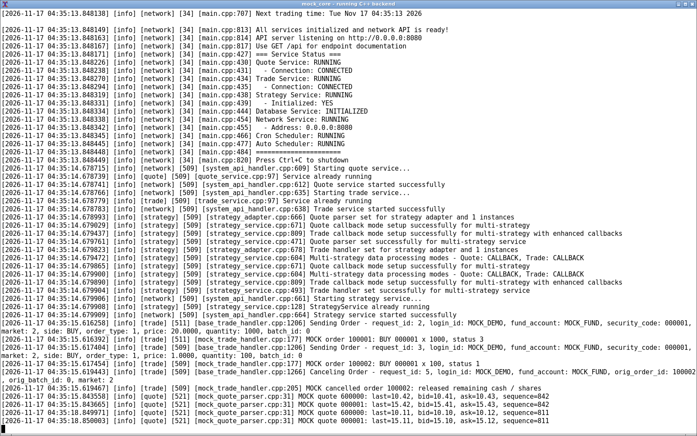

# 核心后台运行与日志

简体中文 · [English](README.en.md)

本例启动独立的 C++ 核心程序。程序加载 mock 行情和交易插件，在终端持续输出服务状态、行情和交易日志。

## 启动后台

准备 Docker 和 Git，在仓库根目录执行：

```bash
docker build -t funiq-trading-mock-dev -f examples/mock_core/Dockerfile .
docker run --rm --name funiq-trading-mock \
  -p 127.0.0.1:18080:8080 -v "$PWD:/app" \
  funiq-trading-mock-dev bash examples/mock_core/start.sh
```

终端会先显示编译和检查结果，然后启动 `ft_trading_client`。看到 `Quote Service: RUNNING`、`Trade Service: RUNNING`、`Strategy Service: RUNNING` 和 `API server listening`，表示后台已运行。该终端会保持打开。



## 查看运行日志

行情插件每三秒记录一次盘口。可在另一个终端查看同一个后台的日志：

```bash
docker logs -f funiq-trading-mock
```

运行一组模拟买入和撤单：

```bash
python3 examples/http_web/exercise.py
```

后台终端会出现下单、模拟成交和撤单记录。



[完整运行日志](../../docs/assets/mock-demo/core-full.txt)

## 文件说明

`start.sh` 启动核心并开启控制台和文件日志。`quote_parser/` 生成模拟行情，`trade_handler/` 保存模拟账户和订单；`*_config.json` 设置插件与账户。运行文件保存在 `build/mock-run/`。

模拟账户初始现金为 100 万元。`600000` 按 10 元、`000001` 按 15 元固定参考价模拟成交；其余限价单保留到撤销。重启后台后账户重置。

## 停止

在后台终端按 Ctrl-C，或执行：

```bash
docker stop funiq-trading-mock
```
