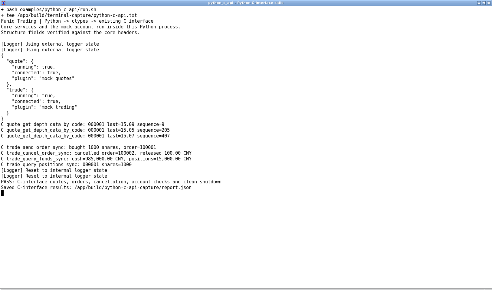

# Python calls through the C interface

[简体中文](README.md) · English

This example calls the compiled core libraries directly from Python. The standard-library `ctypes` module calls the C functions to read quotes, place a simulated buy, cancel an order and query the account.

## Run

With Docker and Git installed, build from the repository root:

```bash
docker build -t funiq-trading-mock-dev -f examples/mock_core/Dockerfile .
docker run --rm -v "$PWD:/app" funiq-trading-mock-dev \
  bash examples/mock_core/build.sh
```

Run the example:

```bash
docker run --rm --network none -v "$PWD:/app" funiq-trading-mock-dev \
  bash examples/python_c_api/run.sh
```

## Result

The terminal shows each C function and its result. The program buys 1,000 shares, places and cancels another 100-share order, then checks cash and positions. Results are saved to `build/python-c-api-capture/report.json`.



[Original output](../../docs/assets/mock-demo/python-c-api.txt)

## Code

`client.py` loads `libquote_service.so` and `libtrade_service.so`, declares function arguments and manages service startup, shutdown and query memory. `structures.py` mirrors the core's data fields; sizes and offsets are checked at startup. `demo.py` shows the complete sequence.

The services run inside the Python process. Each run starts with a fresh 1,000,000 CNY mock account. `000001` fills at a fixed reference price of 15 CNY.
