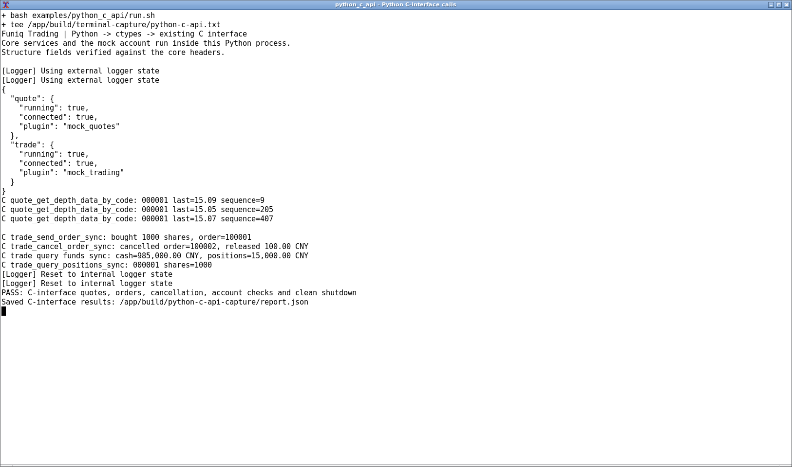

# Python 调用 C 接口

简体中文 · [English](README.en.md)

本例让 Python 直接调用编译好的核心库。Python 标准库中的 `ctypes` 负责调用库里的 C 接口，程序完成行情读取、模拟买入、撤单和账户查询。

## 运行

准备 Docker 和 Git，在仓库根目录编译：

```bash
docker build -t funiq-trading-mock-dev -f examples/mock_core/Dockerfile .
docker run --rm -v "$PWD:/app" funiq-trading-mock-dev \
  bash examples/mock_core/build.sh
```

运行示例：

```bash
docker run --rm --network none -v "$PWD:/app" funiq-trading-mock-dev \
  bash examples/python_c_api/run.sh
```

## 运行结果

终端显示调用的 C 函数和返回结果。程序会买入 1,000 股，挂入并撤销另一笔 100 股订单，然后核对现金和持仓。结果保存到 `build/python-c-api-capture/report.json`。



[原始输出](../../docs/assets/mock-demo/python-c-api.txt)

## 代码说明

`client.py` 加载 `libquote_service.so` 和 `libtrade_service.so`，设置函数参数并管理服务的启动、停止和查询结果内存。`structures.py` 对应核心的数据字段；启动时会检查字段大小和位置。`demo.py` 展示完整调用步骤。

行情和交易服务运行在 Python 进程里。每次运行创建新的模拟账户，初始现金 100 万元，`000001` 按固定参考价 15 元模拟成交。
